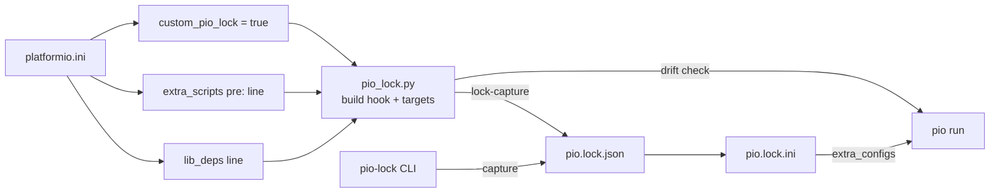

# pio-lock

Dependency lockfile for [PlatformIO](https://platformio.org/) — reproducible builds for embedded projects.

PlatformIO resolves library and platform versions at install time but has no lockfile to record what was actually installed. If your `platformio.ini` uses semver ranges (`^1.8.3`), bare platform names (`espressif32`), git branches, or unpinned git URLs, a fresh install can silently pick up different versions. `pio-lock` fixes this.

## Status

| Feature | Design | Docs | Impl | Tests | Examples | Since | Updated |
|---------|--------|------|------|-------|----------|-------|---------|
| **Dependency scanning** | [pio_lock.py](pio_lock.py) | [README](README.md) | [pio_lock.py](pio_lock.py) | [test_scan](tests/test_scan.py) | [fixtures/](tests/fixtures/) | | |
| **Lockfile generation** | [pio_lock.py](pio_lock.py) | [README](README.md#lockfile-format) | [pio_lock.py](pio_lock.py) | [test_commands](tests/test_commands.py) | [minimal-native](tests/fixtures/minimal-native/) | | 0.4.0 |
| **Platform locking (`pio.lock.ini`)** | [pio_lock.py](pio_lock.py) | [README](README.md#pinning-the-platform) | [pio_lock.py](pio_lock.py) | [test_platform](tests/test_platform.py), [test_integration_build](tests/test_integration_build.py) | | 0.4.0 | 0.4.1 |
| **`init` (add the include)** | [pio_lock.py](pio_lock.py) | [README](README.md#pinning-the-platform) | [pio_lock.py](pio_lock.py) | [test_init](tests/test_init.py) | | 0.4.0 | |
| **Build-time drift check** | [pio_lock.py](pio_lock.py) | [README](README.md#what-a-plain-pio-run-pins) | [pio_lock.py](pio_lock.py) | [test_hook](tests/test_hook.py) | | 0.4.0 | 0.4.1 |
| **Build snapshot** | [pio_lock.py](pio_lock.py) | [README](README.md#reproducible-binaries-build-snapshot) | [pio_lock.py](pio_lock.py) | [test_snapshot](tests/test_snapshot.py) | | | 0.4.0 |
| **Outdated detection** | [pio_lock.py](pio_lock.py) | [README](README.md#updating) | [pio_lock.py](pio_lock.py) | [test_outdated](tests/test_outdated.py) | | | 0.4.0 |
| **Update commands** | [pio_lock.py](pio_lock.py) | [README](README.md#updating) | [pio_lock.py](pio_lock.py) | [test_commands](tests/test_commands.py) | | | 0.4.0 |
| **Git ref tracking** | [pio_lock.py](pio_lock.py) | [README](README.md#lockfile-format) | [pio_lock.py](pio_lock.py) | [test_outdated](tests/test_outdated.py) | | 0.4.0 | |
| **PlatformIO integration** | [pio_lock.py](pio_lock.py) | [README](README.md#setup) | [pio_lock.py](pio_lock.py) | [test_integration](tests/test_integration.py), [test_integration_build](tests/test_integration_build.py) | | | 0.4.0 |
| **`lib_deps`-only setup** | [library.json](library.json) | [README](README.md#setup) | [library.json](library.json) | [test_integration_build](tests/test_integration_build.py), [test_packaging](tests/test_packaging.py) | | 0.4.0 | |
| **Standalone CLI (`pip install`)** | [pyproject.toml](pyproject.toml) | [README](README.md#command-line-tool) | [pio_lock.py](pio_lock.py) | [test_platform](tests/test_platform.py) | | | 0.4.0 |
| **GitHub Actions integration** | | [README](README.md#github-actions) | | | | | |
| **Config source tracking** | [pio_lock.py](pio_lock.py) | | [pio_lock.py](pio_lock.py) | [test_commands](tests/test_commands.py) | | | |

## How it works

`pio-lock` reads your installed PlatformIO dependencies and records their exact versions in `pio.lock.json`, which you commit alongside `platformio.ini`. Later, `restore` reinstalls those exact versions and `check` verifies nothing has drifted. It also writes `pio.lock.ini`, a small PlatformIO config file that pins each env's platform and platform packages — include it from `platformio.ini` and a plain `pio run` builds with the locked platform.

The rule throughout: **`platformio.ini` states what is acceptable; the lock records what you got.** You keep reading and editing `platformio.ini`; the lock files are generated.

It captures, per env:
- **Platform** — the `platform =` spec you wrote and the exact version (or commit) it resolved to
- **Platform packages** — the framework, toolchain and tool versions the env actually uses
- **Registry libraries** — exact resolved version from `.piopm` metadata
- **Git libraries** — exact commit SHA, plus the ref you asked for (`#branch`, `#tag`, `#sha`, or none)
- **Local libraries** — recorded for completeness, skipped during restore

## Quick start

```ini
; platformio.ini
[env:my_env]
platform = espressif32@^6.6.0
lib_deps =
    https://github.com/m-mcgowan/pio-lock.git
    bblanchon/ArduinoJson @ ^7.0.0
```

```bash
# 1. Install your dependencies normally
pio pkg install -e my_env

# 2. Capture the resolved state (writes pio.lock.json and pio.lock.ini)
pio run -t lock-capture -e my_env       # or: pio-lock capture -e my_env

# 3. Pin the platform in plain builds (adds pio.lock.ini to extra_configs)
pio-lock init

# 4. Commit the lock
git add platformio.ini pio.lock.json pio.lock.ini

# 5. On another machine (or in CI), restore exact versions, then build
pio run -t lock-restore -e my_env
pio run -e my_env
```

Step 3 needs the [command-line tool](#command-line-tool); you can also add the line by hand (see [Pinning the platform](#pinning-the-platform)).

## Setup

Pick one. All three give you the build hook and the `lock-*` / `snapshot-*` targets.

**1. `lib_deps` line (recommended).** pio-lock's `library.json` loads the script, so this is all you need:

```ini
[env:myenv]
lib_deps =
    https://github.com/m-mcgowan/pio-lock.git
```

PlatformIO downloads pio-lock into `.pio/libdeps/<env>/pio-lock/` and runs it before your project compiles. pio-lock leaves itself out of the lockfile.

**2. Copy into your project.** If you'd rather not depend on `lib_deps`, copy `pio_lock.py` into your project and load it as an extra script:

```ini
[env:myenv]
extra_scripts = pre:scripts/pio_lock.py
```

**3. pioarduino.** The [pioarduino](https://github.com/pioarduino/platform-espressif32) platform can install pio-lock into its own Python and load it for you:

```ini
[env:myenv]
custom_pio_lock = true
```

Don't combine this with either of the above; if you do, pio-lock loads once and prints which line to remove.

### Upgrading from 0.3.x: the `pre:` line

Earlier versions documented `lib_deps` **plus** an extra script line:

```ini
extra_scripts =
    pre:${PROJECT_LIBDEPS_DIR}/${PIOENV}/pio-lock/pio_lock.py
```

From 0.4.0 the `lib_deps` line loads pio-lock by itself, so this line is redundant. It keeps working — the second load does nothing — but prints:

```
pio-lock: already loaded via lib_deps; the extra_scripts line for pio_lock.py is deprecated since 0.4.0 and can be removed
```

Remove the `extra_scripts` line to silence it. Copy-into-project users (setup 2) get no message.

## How pio-lock is wired in

pio-lock has independent entry points, each doing one job:

| Entry point | Job |
|---|---|
| `lib_deps = …pio-lock…` | **Gets the code** into `.pio/libdeps/<env>/pio-lock/`; from 0.4.0 `library.json` also **loads** the script |
| `extra_scripts = pre:…pio_lock.py` | **Loads** the script (build hook + `lock-*`/`snapshot-*` targets). Needed for copy-into-project users |
| `extra_configs = pio.lock.ini` | **Enforces** the lock in PlatformIO itself (platform + packages). Pure config; works even when pio-lock isn't loaded |
| pioarduino `custom_pio_lock = true` | The platform installs pio-lock into its Python and loads it (gets + loads, not enforces) |
| `pip install pio-lock` | The `pio-lock` command (capture, restore, check, update, init, …) outside a build |



`extra_configs = pio.lock.ini` is optional. Without it, the platform floats as in 0.3.x: builds and `pio-lock check` don't compare the platform, and print a hint to add the include once a 0.4.0 lock exists.

## Pinning the platform

`capture` writes `pio.lock.ini` next to `pio.lock.json`:

```ini
# Generated by pio-lock from pio.lock.json. Do not edit: run `pio-lock capture` instead.
# ...

[env:my_env]
platform = platformio/espressif32@6.7.0
platform_packages =
  platformio/framework-arduinoespressif32@3.20016.0
  espressif/toolchain-xtensa-esp32@8.4.0+2021r2-patch5
  platformio/tool-esptoolpy@1.40501.0
```

- Registry platforms are pinned as `<owner>/<name>@<version>`.
- Git platforms and packages are pinned to the exact commit (`…#<sha>`), even when your spec names a branch or no ref.
- Packages from a URL are written as `<name> @ <url>`, so PlatformIO treats them as overrides of the platform's package.
- Your own `platform_packages` are kept, at their exact resolved versions (in PlatformIO's normalised `git+…` form for git sources), so the generated line never drops them.
- Packages installed from a local `file://` path (for example tools pioarduino installs from its own directory) are recorded and checked in `pio.lock.json`, but left out of `pio.lock.ini` — a local path would break on other machines.

It only takes effect once `platformio.ini` includes it:

```ini
[platformio]
extra_configs = pio.lock.ini
```

Or let `pio-lock init` add it. `init` creates `[platformio]` / `extra_configs` if needed, appends to an existing list, leaves comments and layout alone, and prints the line it added (`--dry-run` previews). It's the only command that edits `platformio.ini` as its main job, and it works from any Python.

To stop pinning the platform, remove `pio.lock.ini` from `extra_configs`.

### Changing the platform

With the include in place, PlatformIO (`pio run`, `pio pkg install -e <env>`) uses the platform `pio.lock.ini` pins, not the `platform =` you just edited. To move to the new one, run:

```bash
pio-lock capture --install -e my_env
```

`--install` installs the platform your `platformio.ini` names, and the packages it needs, when it isn't installed yet — configured from your `platformio.ini`, not from `pio.lock.ini` — then records it in the lock. (`pio-lock update` installs the platforms it moves to the same way.)

### A later config file overriding the lock

PlatformIO reads config files in order and the last value wins. If a file read after `pio.lock.ini` sets `platform` or `platform_packages` for a locked env, that file silently undoes the lock. pio-lock reports this as an error:

```
config/local.ini sets platform for env 'my_env' after pio.lock.ini, overriding the lock; move pio.lock.ini last in extra_configs, or set PIO_LOCK_ALLOW_OVERRIDE=1 / custom_pio_lock_allow_override = true to allow it
```

Move `pio.lock.ini` last in `extra_configs`, or, if the override is deliberate, allow it:

```ini
[env:my_env]
custom_pio_lock_allow_override = true
```

or set `PIO_LOCK_ALLOW_OVERRIDE=1` (or `true` / `yes`) in the environment. Allowed overrides are still reported, as warnings. (`pio-lock check` reads only the environment variable.)

## What a plain `pio run` pins

| With `pio.lock.ini` included | Plain `pio run` |
|---|---|
| Platform version | pinned |
| Platform packages (toolchain, framework, tools) | pinned |
| Libraries | **not pinned** — PlatformIO installs whatever `lib_deps` resolves to if `.pio/libdeps` is missing or stale |

Pinning libraries inside a plain `pio run` is planned for a later release. Until then, close the gap with `restore` and `check`:

- Run `pio run -t lock-restore` before building on a fresh checkout or in CI. It installs the locked platform, packages and libraries.
- Run `pio run -t lock-check` in CI to fail on drift.

```yaml
- name: Restore locked dependencies
  run: pio run -t lock-restore -e my_env

- name: Verify lockfile
  run: pio run -t lock-check -e my_env

- name: Build
  run: pio run -e my_env
```

### The build-time check

When pio-lock is loaded (any [setup](#setup)), every build compares the env being built with `pio.lock.json`: libraries, and — with `pio.lock.ini` included — the platform, its packages, and whether your `platform =` / `platform_packages` changed since the lock was captured. So a plain `pio run` never builds unlocked versions silently.

| Situation | Outside release mode | Release mode |
|---|---|---|
| Drift (wrong version installed, lock stale, a later config overriding the lock, unreadable `pio.lock.json`) | warning, with the command that fixes it | **build fails** (unless the drift policy is `warn`) |
| No `pio.lock.json` | nothing | nothing |
| Env not in `pio.lock.json` | hint to run `capture` | hint |
| v1 lockfile (from 0.3.x) | libraries checked; hint to re-capture for the platform | same |
| v2 lockfile, `pio.lock.ini` not included | libraries checked; hint to add the include | same |
| PlatformIO Core version differs from the locked one | warning | warning |
| pio-lock can't read PlatformIO's internals (unsupported Core) | warning, libraries still checked | **build fails** (unless the drift policy is `warn`) |

The build can't switch platforms or libraries while it runs, so the fix is to install the locked versions and re-run — the message says which command to use (`pio-lock restore -e <env>`, or `pio-lock capture --install -e <env>` when you changed `platformio.ini` on purpose).

The checks don't run when you ask for one of pio-lock's own targets (`lock-*`, `snapshot-*`) — those exist to record, repair or report drift — or for `clean`, `cleanall` or `fullclean`.

**Release mode** is on when any of these is set: `PIO_RELEASE_BUILD=1` in the environment, `custom_reproducible_release = true` in `platformio.ini`, or a pinned build snapshot (`"pinned": true` in `build_snapshot.json`).

**Interactive prompt.** Outside release mode, when there's drift and the build runs in a terminal (stdin is a terminal and PlatformIO reports its output as one), the build asks:

```
Continue with this build? [c]ontinue / [a]bort:
```

An empty answer aborts. This includes IDE task terminals (VS Code), where the build waits for your answer. Set `PIO_LOCK_DRIFT=warn` to build without asking. Release builds never prompt.

### Settings

| `platformio.ini` option | Environment variable | Values | Default |
|---|---|---|---|
| `custom_pio_lock_drift` | `PIO_LOCK_DRIFT` | `fail`, `warn` (any case) | `fail` (in release mode; outside it drift always warns) |
| `custom_pio_lock_allow_override` | `PIO_LOCK_ALLOW_OVERRIDE` | `true`, `1` or `yes` (any case); the variable also takes `false`, `0` or `no` to turn it off over the option | off: a later config overriding the lock is drift |
| `custom_reproducible_release` | `PIO_RELEASE_BUILD` | `true` (option) / `1` (variable) | off |

The environment variable wins over the `platformio.ini` option. An unrecognised value is ignored: the option, then the default, applies.

### Turning errors into warnings

`pio run` has no way to pass extra flags to pio-lock, so use the environment variable or the ini option:

```bash
PIO_LOCK_DRIFT=warn pio run -e my_env
```

```ini
[env:my_env]
custom_pio_lock_drift = warn
```

From the command line, `pio-lock check --warn-only` (or `PIO_LOCK_DRIFT=warn pio-lock check …`) reports drift as warnings and exits 0.

## Duplicate library copies

PlatformIO can install a library more than once in `.pio/libdeps/<env>/` — `SparkFun u-blox GNSS v3/` next to `SparkFun u-blox GNSS v3@3.1.13/`, or a git library next to `<name>@src-<hash>/` checkouts. pio-lock tells two situations apart:

- **Installed duplicates** — several copies sit in libdeps, but the build uses one. pio-lock records every copy (with its `dir`) and prints a warning in `capture`, `restore`, `check` and the build; it never fails anything. `check` compares a duplicated library's lock entry against its recorded `dir`; an entry without one isn't compared against an arbitrary copy, so the warning replaces a misleading "expected …".
- **Linked duplicates** — two or more copies are built into the same image. In C/C++ this is a real fault: each library becomes its own `.a` archive, and all of them share one symbol namespace, so the image either breaks the one-definition rule or silently mixes functions from different versions. Just before linking, pio-lock checks the libraries PlatformIO built; in a locked project (`pio.lock.json` present) linked duplicates fail a release build (unless `PIO_LOCK_DRIFT=warn` / `custom_pio_lock_drift = warn`), and otherwise they warn.

```text
WARNING: duplicate copies of 'SparkFun u-blox GNSS v3': SparkFun u-blox GNSS v3 (3.1.15; requested by lib_deps: sparkfun/SparkFun u-blox GNSS v3 @ ^3.1.7), SparkFun u-blox GNSS v3@3.1.13 (3.1.13; requested by lib/board_support: SparkFun u-blox GNSS v3@3.1.13); make the requirements agree so only one copy is installed; lib/board_support pins 'SparkFun u-blox GNSS v3' to 3.1.13 — prefer a range (e.g. ^3.1.0) in library.json
```

To resolve either, make the requirements agree so only one copy is installed, then delete `.pio/libdeps/<env>` (or the extra directories) and reinstall. The usual cause is a library pinning a dependency exactly — `"version": "3.1.13"`, `==3.1.13` or a git `#<sha>`/tag in its `library.json` — while the project or another library asks for a range. Libraries should declare ranges (`^3.1.0`) and leave exact versions to the project's lock; the report names the library that pins.

## Updating

`pio-lock outdated -e <env>` reports what's newer, read-only:

- registry libraries (current / wanted within your range / latest)
- registry platforms, and newer GitHub release URLs for URL platforms
- git libraries on a branch whose head moved past the locked commit, and newer version tags

`pio-lock update -e <env>` moves forward. Following the rule above, it always moves the lock, and moves `platformio.ini` only where your spec has a version to move:

| Your spec | `update` changes |
|---|---|
| `bblanchon/ArduinoJson @ ^7.0.0`, newer `7.2.1` | lock → 7.2.1, ini → `^7.2.1` (raises the floor to the version you now use) |
| `platform = espressif32@6.6.0`, newer `6.7.0` | lock → 6.7.0, ini → `espressif32@6.7.0` |
| release URL `…/releases/download/53.03.10/…zip` | lock and ini → the newer release URL |
| git tag `…#v1.2.0`, newer `v1.3.0` | lock and ini → `#v1.3.0` |
| bare `espressif32`, `bblanchon/ArduinoJson` | lock only (no version to edit) |
| git branch `…#main`, or no ref | lock only: the locked commit moves to the branch head |
| git `…#<sha>` | nothing (an explicit pin) |
| newer version outside your range (`^6.6.0`, newer `7.0.0`) | reported and left alone; `--beyond-range` moves it |

- Exact pins (`@6.6.0`) move within the same major version; crossing a major needs `--beyond-range`.
- Partial versions (`@6`, `@6.6`) are ranges: the lock moves within them and the ini is left as written.
- A spec pio-lock can't rewrite (for example `>=1,<2`) is left as written while the lock moves within it; a `--beyond-range` move past such a spec is reported with `edit the ini by hand` and not made.
- With `--lock-only`, a library never moves outside what its `lib_deps` spec allows — past the range, off an exact pin (`@1.0.0`), or to another git tag — because a plain `pio run` still enforces `lib_deps` and would install a second, matching copy. Such a move is reported with `edit the ini (or drop --lock-only)` and not made; moves within the range still happen. Platforms can move with `--lock-only`: `pio.lock.ini` overrides their spec.
- If the edited line sits in a section other envs share (`[env]`, or a base section), `update` names those envs and tells you to run `pio-lock update -e <env>` for them, so their locks catch up.
- Old git checkouts are cleaned up after a move.
- An env whose `platform =` changed since the last capture isn't held at its old locked platform: `update` records the platform your spec now resolves to, or, if that isn't installed, keeps the old lock and says to run `pio-lock capture --install -e <env>`.

| Flag | Effect |
|---|---|
| `--dry-run` | Show what would change; install nothing, write nothing |
| `--lock-only` | Move only the lock (`pio.lock.json`, `pio.lock.ini`); leave `platformio.ini` alone. Libraries only move within what `lib_deps` allows |
| `--beyond-range` | Also move to versions outside the range `platformio.ini` declares |
| `--lib NAME` | Update only libraries matching `NAME` (platforms are left alone) |
| `--apply` | Deprecated, does nothing: `update` applies by default |

`update` prints each change and each file it edited, and ends with `platformio.ini changed — review and commit it with pio.lock.json` when it touched your config. It no longer writes `.bak` files — your config is in git.

This deliberately follows pnpm and Yarn 2+ (the manifest moves with the lock) rather than Cargo and npm (lock only by default): since you read `platformio.ini`, not the lock, it should say what you're actually building with. Use `--lock-only` for the Cargo/npm behaviour.

`outdated` and `update` use the GitHub API for git dependencies and release URLs; set `GITHUB_TOKEN` or install the `gh` CLI, otherwise those checks are skipped with a note.

## Command-line tool

```bash
pip install pio-lock          # or: pipx install pio-lock
pio-lock capture -e esp32s3-idf
```

Locking the platform needs PlatformIO's own Python modules. When `platformio` isn't importable from the Python you installed into, `pio-lock` finds PlatformIO's Python (via `pio system info`) and re-runs itself there — about 0.7–1 s of extra startup. If that fails, it says so and locks libraries only; install into PlatformIO's Python instead:

```bash
~/.platformio/penv/bin/pip install pio-lock
```

You can also run the script directly: `python pio_lock.py <command>`.

```bash
pio-lock capture -e esp32s3-idf
pio-lock capture -e esp32s3-idf -e esp32s3   # multiple envs
pio-lock restore -e esp32s3-idf
pio-lock check -e esp32s3-idf                # exit 0 = match, 1 = drift
pio-lock outdated -e esp32s3-idf
pio-lock update -e esp32s3-idf --dry-run
pio-lock init
```

| Command | Does |
|---|---|
| `capture -e ENV…` | Record what's installed for each env in `pio.lock.json` and regenerate `pio.lock.ini`. No network, no installs; an env whose platform isn't installed is an error. `--install` installs it first, from your `platformio.ini` (see [Changing the platform](#changing-the-platform)). Other envs' entries are kept; envs no longer in `platformio.ini` are pruned. If pio-lock can't read PlatformIO's internals, it keeps the env's previous platform lock and warns. An unreadable `pio.lock.json` (a merge conflict, say) is replaced, with a warning. `--output PATH` writes elsewhere |
| `restore -e ENV…` | Install the locked platform and packages, then the locked libraries |
| `check -e ENV…` | Compare installed platform, packages and libraries with the lock; exit 1 on drift. The platform is compared only with `pio.lock.ini` included, as in the build. `--warn-only` reports and exits 0 |
| `outdated -e ENV…` | Report newer versions (`--json` for machine-readable output); exit 1 when updates exist |
| `update -e ENV…` | Move the lock (and `platformio.ini` within range) forward — see [Updating](#updating) |
| `init` | Add `pio.lock.ini` to `[platformio] extra_configs` (`--dry-run` previews) |
| `snapshot-capture`, `snapshot-check`, `snapshot-clear`, `snapshot-print` | Manage `build_snapshot.json` |

All commands take `-d, --project-dir` (default: the current directory), before or after the command name: `pio-lock -d app check -e esp32` and `pio-lock check -e esp32 -d app` are the same.

### PlatformIO targets

With pio-lock loaded in the build (see [Setup](#setup)):

```bash
pio run -t lock-capture    # capture dependency versions
pio run -t lock-check      # verify no drift
pio run -t lock-restore    # restore from lockfile
pio run -t snapshot-capture
```

The `lock-*` targets act on the env being built: `pio run -e my_env -t lock-capture` captures `my_env` only. Without `-e`, PlatformIO runs each env in `default_envs` (every env when `default_envs` is unset), and only envs that load pio-lock register the targets; for full coverage pass each env with `-e`, or use the CLI (`pio-lock capture -e a -e b`). They don't appear in `pio run --list-targets`.

## GitHub Actions

```yaml
- name: Cache PlatformIO Dependencies
  id: cache
  uses: actions/cache@v4
  with:
    path: |
      ~/.platformio/platforms
      ~/.platformio/packages
      .pio/libdeps
    key: pio-${{ hashFiles('pio.lock.json', 'platformio.ini') }}
    restore-keys: pio-

- name: Restore locked dependencies
  if: steps.cache.outputs.cache-hit != 'true'
  run: pio run -t lock-restore -e esp32s3-idf

- name: Verify lockfile consistency
  run: pio run -t lock-check -e esp32s3-idf

- name: Release build
  run: pio run -e esp32s3-idf
  env:
    PIO_RELEASE_BUILD: "1"   # drift fails the build
```

## Reproducible binaries (build snapshot)

On every build pio-lock sets `SOURCE_DATE_EPOCH` from `build_snapshot.json`, so `__DATE__`/`__TIME__` are deterministic. The epoch is the HEAD commit's time on a clean tree, so the same commit gives the same epoch everywhere; a dirty tree falls back to the current time and prints `non-reproducible: …`. The snapshot's epoch overrides any `SOURCE_DATE_EPOCH` already set. In release mode a missing or stale snapshot fails the build; run `pio run -t snapshot-capture` (which works in release mode).

## Lockfile format

`pio.lock.json`, format v2:

```json
{
  "_comment": "Generated by pio-lock. Do not edit manually.",
  "lockfile_version": 2,
  "generated_at": "2026-11-11T10:00:00Z",
  "generated_from_commit": "abc1234",
  "pio_core_version": "6.1.18",
  "envs": {
    "esp32s3-idf": {
      "platform": {
        "spec": "espressif32@^6.6.0",
        "platform_packages_spec": [],
        "name": "espressif32",
        "version": "6.7.0",
        "src_url": null,
        "owner": "platformio",
        "packages": [
          {
            "name": "framework-espidf",
            "version": "3.50201.240515",
            "owner": "platformio",
            "src_url": null
          },
          {
            "name": "toolchain-xtensa-esp32s3",
            "version": "12.2.0+20230208",
            "owner": "espressif",
            "src_url": null
          }
        ]
      },
      "libraries": [
        {
          "name": "Blues Wireless Notecard",
          "type": "registry",
          "version": "1.8.4",
          "owner": "blues",
          "dir": "Blues Wireless Notecard"
        },
        {
          "name": "esp-nimble-cpp",
          "type": "git",
          "url": "https://github.com/user/esp-nimble-cpp.git",
          "sha": "32e7ca2d2d387d74eaeac09751049778faea4040",
          "ref": "main",
          "ref_type": "branch",
          "dir": "esp-nimble-cpp"
        },
        {
          "name": "my-local-lib",
          "type": "local",
          "path": "file://lib/my-local-lib",
          "dir": "my-local-lib"
        }
      ]
    }
  }
}
```

- `platform.spec` and `platform.platform_packages_spec` are what you wrote in `platformio.ini` (ignoring `pio.lock.ini`); a change to either makes the env's lock stale.
- `platform.src_url` / `packages[].src_url` are set for git and URL sources.
- Git libraries record the requested `ref` and its `ref_type` (`branch`, `tag`, `sha`, or `default` for no ref).
- `dir` is the library's directory in `.pio/libdeps/<env>/` (including `@<version>` and `@src-<hash>` copies); `check` and `restore` compare an entry against that directory when it exists. Entries without `dir` (older locks) are matched by name or git URL.

Format v1 (0.3.x and earlier) had top-level `platform_url` and `global_packages` instead of per-env `platform`. pio-lock still reads v1 files — libraries work as before, platform checks are skipped with a hint — and `capture` always writes v2. Re-run `capture` to upgrade.

## What this solves

| Problem | How pio-lock helps |
|---------|-------------------|
| `lib @ ^1.8.3` resolves to 1.8.4 today, 1.8.5 tomorrow | Locks to exact version (`==1.8.4`) |
| `platform = espressif32` picks up a new platform (and toolchain) on a fresh machine | `pio.lock.ini` pins the platform and its packages in every build |
| Git dep on a branch (`#fix/something`) | Locks to exact commit SHA; `outdated` reports when the branch moves |
| Unpinned git URL (no `#ref` at all) | Locks to exact commit SHA |
| Transitive deps resolved at install time | All resolved deps captured in lockfile |
| "What libraries were in release v1.2.3?" | Lockfile committed with the release tag |
| CI cache hit with stale deps | `check` and the build-time check detect drift |

## What this doesn't solve

- ~~**Bit-for-bit identical binaries** — ESP-IDF embeds timestamps; same source doesn't guarantee identical bytes~~ The [build snapshot](#reproducible-binaries-build-snapshot) sets `SOURCE_DATE_EPOCH` to produce deterministic `__DATE__`/`__TIME__` macros, enabling reproducible builds.
- **Libraries in a plain `pio run`** — pinned by `restore` and checked on every build, but not enforced by PlatformIO itself yet (planned).
- **PlatformIO Core version enforcement** — recorded in the lockfile; a build on a different Core version prints a warning.

## For integrators

- `register_pio_targets(env)` is the entry point for platforms that load pio-lock themselves (pioarduino's `custom_pio_lock`); its name and signature are unchanged in 0.4.0. Calling it more than once in a build is safe.
- The lockfile is format v2 from 0.4.0 (see [Lockfile format](#lockfile-format)).
- pio-lock is pre-1.0: the Python API and the lockfile format may change between minor versions, with changes listed in the [CHANGELOG](CHANGELOG.md). Pin the version you integrate with.

## Contributing

For how pio-lock is put together and why, see [docs/architecture.md](docs/architecture.md).

### Developer setup

```bash
./scripts/dev-setup.sh
source .venv/bin/activate
```

This creates a venv, installs dev dependencies, and sets up git hooks:
- **pre-commit** — ruff lint/format + unit tests
- **pre-push** — unit tests on regular pushes, full suite (unit + integration) on tag pushes

### Running tests

```bash
# Unit tests only (fast, no PIO needed)
make test

# All tests including integration (needs PIO installed)
make test-all

# Integration tests against a specific PlatformIO version, in a throwaway venv
# with its own PLATFORMIO_CORE_DIR (never touches ~/.platformio)
make test-pio PIO=6.2.0
```

Integration tests build small projects on PlatformIO's `native` platform. CI runs them on PlatformIO 6.1.18 (oldest supported), the current 6.2.x and the latest release, and a weekly scheduled run catches new PlatformIO releases even when pio-lock hasn't changed.

### Reproducing a bug

To add a test case from a bug report:

1. Create `tests/fixtures/<issue-name>/`
2. Add a minimal `platformio.ini`
3. Add `.pio/libdeps/<env>/` with the library state that triggers the bug
4. Optionally add `expected.json` with expected output
5. Add a `README.md` describing the scenario

See `tests/fixtures/README.md` for the full format.

### Code quality

```bash
make lint             # ruff lint + format check + mypy
```

Pre-commit hooks run lint + unit tests automatically. Integration tests run on tags.

## Requirements

- Python 3.9+
- PlatformIO Core 6.1.18 or later
- git CLI

## License

MIT
