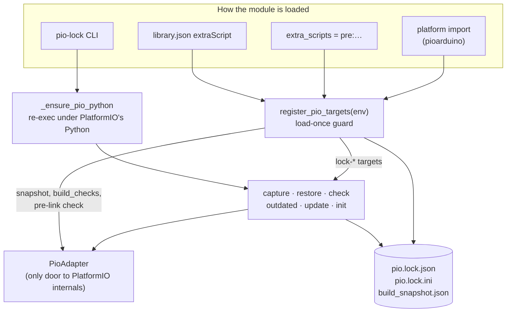

# pio-lock architecture

This document is for people changing pio-lock. It explains how the pieces fit together and why the code is
shaped the way it is. The [README](../README.md) covers how to use pio-lock; this document doesn't repeat that.

## The rule everything follows

**`platformio.ini` states what is acceptable. The lock records what you got.**

Developers read and edit `platformio.ini`. They rarely read lockfiles. So:

- `capture` records what is installed. It never edits `platformio.ini`.
- `restore` installs what the lock records. It never edits `platformio.ini`.
- `update` moves the lock forward, and by default also raises the version written in the ini, in the style
  it was written (`^1.8.3` → `^1.8.5`). A bare spec, a branch ref or `--lock-only` moves only the lock. A
  version outside the declared range is reported and left alone unless `--beyond-range` is given.
- `init` is the only other command that edits the ini, and only because the user ran it to add the include.

When adding a feature, ask which side of the rule it is on. A change that quietly rewrites user config, or
that keeps building an old version after the user deliberately changed the ini, breaks the rule.

## One module

pio-lock is a single file, `pio_lock.py`. That is deliberate: the same file is

1. a PlatformIO library's `extraScript` (loaded through `library.json` when pio-lock is in `lib_deps`),
2. a `pre:` extra script copied into a project,
3. a module imported by a platform (pioarduino calls `register_pio_targets(env)`), and
4. the `pio-lock` command-line tool (`main()`).

Keep it importable without PlatformIO installed. PlatformIO is imported lazily, inside `PioAdapter`
methods, so the unit tests and the CLI's first few lines run on any Python 3.9+.



## Files pio-lock writes

| File | Written by | Read by | Purpose |
|---|---|---|---|
| `pio.lock.json` | `capture`, `update` | `restore`, `check`, `outdated`, build hook | The full record: per env, the platform (spec, resolved version, packages) and each library (version, `dir`, git sha and ref). `lockfile_version: 2`. |
| `pio.lock.ini` | `capture`, `update` (rendered from the JSON) | PlatformIO itself, via `extra_configs` | Pins `platform` and `platform_packages` per env so a plain `pio run` uses the locked versions. |
| `build_snapshot.json` | `snapshot-capture`, or the build hook outside release mode | build hook | Commit and epoch for `SOURCE_DATE_EPOCH`, so `__DATE__`/`__TIME__` are repeatable. |

All three are written atomically (`_atomic_write_json`, `_atomic_write_text`).

`pio.lock.ini` is a view of `pio.lock.json`. Never edit it by hand, and never give it information the JSON
lacks. `render_lock_ini` is the only thing that writes it. Git sources are pinned to `#<sha>`, registry
packages to `name @ version`, and `file://` packages are left out, because a path on one machine means
nothing on another.

## Two views of the project config

PlatformIO reads `platformio.ini` and then each `extra_configs` file in turn. A value read later overrides
an earlier one. Once `pio.lock.ini` is included, PlatformIO's own `ProjectConfig` reports the *locked*
platform, not the one the user asked for. pio-lock needs both:

- `PioAdapter.user_config()`: everything except `pio.lock.ini`. This is "what the user asked for". `capture`
  resolves from it, and the stale-lock check compares the locked `spec` and `platform_packages_spec` with it.
- `PioAdapter.full_config()`: everything, as PlatformIO sees it. The override check uses it.

Both are built by `_read_config_view`, which copies the way `ProjectConfig.read` walks `extra_configs`, with
two differences:

- PlatformIO resolves `extra_configs` globs against the process's **working directory**, not the project
  directory. `pio-lock -d other/project` would silently miss the include.
- PlatformIO expands `${PROJECT_DIR}` from `os.getcwd()`.

The view resolves both against `project_dir`. Don't replace it with `ProjectConfig.get_instance()`. That
call caches one config per process and always includes the lock.

### Later configs overriding the lock

pio-lock does not require `pio.lock.ini` to be the last file listed. Instead, `lock_overrides` finds any
file read *after* it that sets `platform` or `platform_packages` for a locked env. A build stops on that.
`custom_pio_lock_allow_override = true` or `PIO_LOCK_ALLOW_OVERRIDE=1` turns it into a warning.

## `PioAdapter`: the only door to PlatformIO internals

Platform resolution uses parts of PlatformIO that are not a documented API: `PlatformFactory`,
`PlatformPackageManager`, `PlatformBase.packages` and others. Those can change between Core releases,
and pioarduino ships a forked Core. So:

- **All** PlatformIO internals go through `PioAdapter`. Nothing else in the module imports `platformio`.
- `_PIO_INTERNALS` lists every `(module, attribute)` the adapter uses. `probe()` checks them in order and
  raises `PioIncompatible`, naming the first missing one and the Core version.
- `_lookup` turns a missing import or attribute into `PioIncompatible`. `_calling` and `_bound` do the same
  for a changed signature (`TypeError`/`AttributeError`), and `_bound` checks the arguments with
  `inspect.signature` before calling. An error the call itself raises (network failure, a package that
  doesn't exist) is **not** incompatibility. It stays a normal error, or a `PlatformInstallError` for installs.
- Resolution looks only at installed packages. `install_platform` is the one method that installs.

**When you need something new from PlatformIO:** add a method to `PioAdapter`, add each new attribute to
`_PIO_INTERNALS`, and add the method to `FakePioAdapter` in `tests/fakes.py`.

### What happens when PlatformIO is incompatible

Libraries are scanned from `.pio/libdeps` on disk and don't need the adapter, so they keep working.
Platform locking is skipped with a warning. In **release mode**, a build with a v2 lock **fails**
instead, because a release must not silently lose its platform lock.

## The build hook

`register_pio_targets(env)` is the public entry point, and pioarduino depends on its name and signature.
Each build env calls it once, in this order:

```mermaid
sequenceDiagram
    participant PIO as pio run
    participant Hook as register_pio_targets
    participant Snap as snapshot_auto_manage
    participant Checks as build_checks
    participant Link as pre-link check

    PIO->>Hook: load (library.json / pre: / import)
    Hook->>Hook: _already_loaded? (marker on DefaultEnvironment)
    Hook->>PIO: AddCustomTarget lock-* and snapshot-*
    Hook->>Snap: set SOURCE_DATE_EPOCH
    Hook->>Checks: compare env with pio.lock.json
    Checks-->>PIO: warn / prompt / env.Exit(1)
    Hook->>PIO: queue pre-link action (_PIO_DELAYED_ACTIONS)
    PIO->>PIO: compile libraries and sources
    PIO->>Link: before linking the program
    Link-->>PIO: 0, or 1 to stop the build
```

Details that are easy to break:

- **Load-once guard.** The same build can load pio-lock up to three ways: a platform import, a `library.json`
  extraScript, and a legacy `pre:` line. These are different module objects, so a module-level global
  can't detect a repeat load. The marker `PIO_LOCK_LOADED_BY` lives on SCons's shared
  `DefaultEnvironment()`. A second load prints a hint and does nothing else. Registering a custom target
  twice would make PlatformIO fail with an `AssertionError`.
- **pio-lock's own targets skip the checks.** If the command line asks for any `LOCK_TARGETS` (`lock-*` or
  `snapshot-*`), `build_checks` and the link check don't run, and the snapshot isn't rewritten. Those
  targets exist to record, repair or report drift. Without this, `pio run -t snapshot-capture` in release
  mode would stop on the missing snapshot it was asked to create. Clean runs (`-t clean`, or SCons
  `--clean`) skip the checks too.
- **lock-\* targets act on the env being built**, `$PIOENV`, and not on every env. `pio run -t lock-capture`
  runs the hook once per env anyway.
- **The pre-link check is registered through `_PIO_DELAYED_ACTIONS`.** PlatformIO defines the program node
  after extra scripts run. An `AddPreAction` on it made before then is replaced, and only the delayed list
  survives.
- **The interactive prompt** shows only when stdin is a terminal and SCons's `ARGUMENTS["ISATTY"]` is set.
  PlatformIO pipes SCons's stdout, so the build can't check stdout itself. PlatformIO passes `ISATTY=1`
  when its own stdout is a terminal.

### Drift policy

| Situation | Outside release mode | Release mode |
|---|---|---|
| No `pio.lock.json` | no checks | no checks |
| Library or platform drift | warn (prompt if interactive) | **fail**, unless `PIO_LOCK_DRIFT=warn` / `custom_pio_lock_drift = warn` |
| Lock stale (user's spec changed since capture) | warn | fail (same opt-out) |
| v1 lock | library checks; platform skipped with a re-capture hint | same |
| v2 lock, `pio.lock.ini` not included | hint only; the user hasn't opted in to platform pinning | hint only |
| Incompatible PlatformIO | warn | fail |
| Installed duplicate library copies | warn | warn |
| Linked duplicate library copies | warn | fail (same opt-out) |
| Core version differs from the lock | warn | warn |

Release mode means `PIO_RELEASE_BUILD=1`, `custom_reproducible_release = true`, or a pinned snapshot. Each
setting pairs an ini option with an environment variable, so CI can override a project's setting without
editing the ini. `check --warn-only` is the CLI equivalent of the drift opt-out.

## Duplicate library copies

PlatformIO builds each library into its own `.a` archive, but all of them share one symbol namespace. Two
versions of one library in an image either break the one-definition rule or silently mix functions from
both versions. pio-lock treats this as a fault, not a style issue.

How duplicates arise:

- Project `lib_deps` resolve to the best match for the spec.
- A library's own dependencies resolve to the *first compatible directory already present*.
- A git library installed at a different ref goes into `<name>@src-<md5 of the URI>`.

So a library that pins a dependency exactly (`"version": "3.1.13"` in its `library.json`), alongside a project
that asks for a range, ends up with two directories.

pio-lock separates two cases:

- **Installed duplicates** (`find_duplicate_libraries`, which works from the directories on disk) only warn.
  Usually just one copy is built.
- **Linked duplicates** (`linked_duplicate_problems`, which works from PlatformIO's library builders just
  before linking) count as drift.

Both reports name the requirement that caused each copy (`_attribute_requirements`) and give advice when a
library pins exactly. The fix belongs in the library: use ranges and leave exact versions to the project's
lock.

The integration tests that build a real double link (`test_build_fails_in_release_when_two_copies_are_linked`
and its neighbours in `tests/test_integration_build.py`) must stay. They are the only check that the
pre-link hook still sees PlatformIO's library builders (`env.GetLibBuilders()`).

## The CLI and PlatformIO's Python

Platform locking needs `import platformio`, but `pip install pio-lock` usually installs into a different
Python from PlatformIO's. `_ensure_pio_python` re-runs the script with `python -I` under PlatformIO's
interpreter, which it finds through `python_exe` in `pio system info --json-output`. Isolated mode stops the
caller's `PYTHONPATH` and site-packages from shadowing PlatformIO's dependencies. The `PIO_LOCK_REEXEC`
marker prevents a loop. If no suitable interpreter is found, the CLI warns and keeps locking libraries.

## Tests

| Kind | Where | Needs PlatformIO | Run with |
|---|---|---|---|
| Unit | most of `tests/test_*.py` | no | `make test` |
| Integration | marked `integration` (`test_integration.py`, `test_integration_build.py`) | yes | `make test-all`, or `make test-pio PIO=<version>` |

- Unit tests replace the adapter through the `fake_pio` fixture, which swaps `_pio_adapter_factory` for a
  `FakePioAdapter` (`tests/fakes.py`). `FakeConfigView` models just the `ProjectConfig` behaviour pio-lock
  relies on (`[env]` fallback, multi-value options).
- Integration tests build small projects on PlatformIO's `native` platform, using helpers in
  `tests/pio_project.py` (`make_native_project`, `piolock_lib`, `run_pio`, `run_in_pio_python`). The
  session fixture `native_platform` installs `native` once.
- `make test-pio PIO=<version>` creates `.venv-pio-<version>` and `.pio-core-<version>`, so a run never
  touches `~/.platformio`. CI runs the integration tests on PlatformIO 6.1.18 (oldest supported), the
  current 6.2.x and the latest release, plus a weekly scheduled run that catches a new PlatformIO release
  even when pio-lock hasn't changed.
- Bug fixes start with a failing test, as covered in the README's [Contributing](../README.md#contributing) section.

## Compatibility promises

- `register_pio_targets(env)` keeps its name and signature. pioarduino imports it.
- The lockfile format and the rest of the Python API may change between minor versions while pio-lock is
  pre-1.0. List every change in `CHANGELOG.md`, so integrators who pin a version know what to update.
- `capture` writes the current `lockfile_version`. Older lockfiles stay readable, with reduced checks and a
  hint to re-capture.
- `library.json`'s `version` must match `pyproject.toml`. `tests/test_packaging.py` checks this.
